<h1 align="center">ene</h1>

<p align="center">
글로 쓰면, 데이터가 움직입니다.
</p>

<p align="center">
<a href="./README.md">English</a>
</p>

---

## 목차

- [소개](#소개)
- [예제](#예제)
- [시작하기](#시작하기)
- [사용법](#사용법)
- [문법](#문법)
- [릴리스](#릴리스)
- [관련 프로젝트](#관련-프로젝트)
- [기여](#기여)
- [보안](#보안)

## 소개

아키텍처 다이어그램은 **무엇이 연결돼 있는지**는 보여 주지만, **무슨 일이 일어나는지**는 잘 보여 주지 못합니다. 어떤 요청이 먼저 가는지, 어디서 기다리고 어디서 실패하는지, 캐시를 놓치면 어느 길로 가는지 같은 것들입니다.

ene 는 몇 줄의 텍스트를, 데이터가 화살표를 따라 실제로 이동하는 다이어그램으로 바꿉니다. 다이어그램에는 플레이어가 함께 나옵니다. 재생, 정지, 한 단계씩 넘기기, 속도 조절이 되고, 갈림길을 골라 다른 경로를 다시 재생할 수 있습니다. 스스로 재생되는 SVG 로 내보내면 GitHub README 처럼 이미지가 들어가는 곳 어디에나 붙일 수 있습니다.

## 예제

**ene 가 지원하는 다이어그램과 기능의 예입니다.**

### 흐름

```
title Order request
user[User] -> api[API Server] : POST /order
api -> cache[Redis] : check stock
cache --> api : miss
api -> db[MySQL] : SELECT stock & api -> pay[Payment] : charge
db --> api : in stock
pay -x api : timeout
api --> user : 502 retry later
```


### 갈림길

```
title Cache hit / miss
client[Client] -> api[API] : GET /product/42
api -> redis[Redis] : GET product:42
branch cache hit
  redis --> api : product
else cache miss
  redis --> api : nil
  api -> db[MySQL] : SELECT
  db --> api : product
  api -> redis : SET product:42
end
api --> client : 200
```


### 대기와 재시도

```
title Payment retry
order[Order Service] -> pg[Payment Gateway] : authorize
pg -x order : timeout
wait 1
order -> pg : authorize (retry 1)
pg -x order : 503
wait 2
order -> pg : authorize (retry 2)
pg --> order : approved
order -> ledger[Ledger] : record payment
```


### 그룹, 모양, 아이콘

```
title Order service in a VPC
user[User]{icon: logos:chrome, shape: circle} -> alb[ALB]{icon: logos:aws-elb} : HTTPS
alb -> api[Order API]{icon: logos:aws-ec2} : /orders
api -> cache[Redis]{icon: logos:redis, shape: db} : check stock
cache --> api : hit
api -> db[Orders DB]{icon: logos:aws-rds, shape: db, color: #f59e0b} : INSERT
db --> api : OK
api -> q[SQS]{icon: logos:aws-sqs, shape: queue} : order.created
q -> worker[Worker]{icon: logos:aws-lambda} : consume
worker -> mail[SES]{icon: logos:aws-ses} : confirmation email
api --> user : 201
group vpc[VPC 10.0.0.0/16]{color: #8b5cf6} : alb api cache db worker
group pub[Public subnet]{color: #22c55e} in vpc : alb
group priv[Private subnet]{color: #3b82f6} in vpc : api cache db worker
```



### 시퀀스 다이어그램

```
diagram sequence
title Checkout sequence
user[User] -> api[Order API] : POST /checkout
api -> redis[Redis]{shape: db} : check stock
branch in stock
  redis --> api : OK
  api -> pg[Payment Provider] : authorize
  pg --> api : approved
  api --> user : 201
else sold out
  redis -x api : sold out
  api --> user : 409
end
```


더 많은 예제는 [`packages/core/examples`](packages/core/examples) 에 있습니다.

## 시작하기

ene 는 아직 npm 에 배포되지 않았어요. 소스에서 빌드해 써요.

**필요한 것:** Node.js 20 이상, pnpm 10(`corepack enable` 을 켜면 `package.json` 에 고정된 버전을 써요).

```bash
git clone https://github.com/slop-makers/ene.git
cd ene
pnpm install
pnpm build          # 모든 패키지와 브라우저 번들을 빌드해요

printf 'user -> api : GET /\napi --> user : 200\n' > flow.ene
node packages/cli/bin/ene.mjs flow.ene -o flow.svg
```

`ene` 명령으로 쓰려면 별칭을 만들어 두세요: `alias ene="node $PWD/packages/cli/bin/ene.mjs"`.

`pnpm test`·`pnpm typecheck` 로 검사하고, `pnpm demo` 는 `demo/`·`site/` 를 다시 만들어요.

## 사용법

### 웹 페이지에서

```html
<pre class="ene">
user -> api : GET /
api --> user : 200
</pre>

<script src="ene.js"></script>
```

페이지의 모든 `<pre class="ene">` 가 플레이어로 바뀝니다. 클릭한 뒤 <kbd>Space</kbd> 로 재생·정지, <kbd>←</kbd> <kbd>→</kbd> 로 한 단계씩 움직입니다.

### 이미지로

```bash
ene flow.ene -o flow.svg
cat flow.ene | ene - > flow.svg   # "-" 는 stdin 에서 읽고, 결과는 stdout 으로
ene flow.ene -o -                # SVG 를 stdout 으로
```

렌더링 없이 검사만 하려면 `check` 를 써요(오류가 있으면 종료 코드 1). `--json` 은 도구·AI 에이전트용으로 진단을 JSON 으로 출력해요:

```bash
ene check flow.ene --json
# [{"code":"E401","severity":"error","line":3,"col":5,"length":5,"message":"unknown node \"cahce\"","hint":"did you mean \"cache\"?","suggestion":"cache"}]
```

소스를 표준 형식으로 정리해요(주석은 그대로 두고, 의미가 바뀔 수 있는 줄은 건드리지 않아요):

```bash
ene fmt flow.ene            # 출력
ene fmt --write *.ene       # 파일에 덮어쓰기
ene fmt --check *.ene       # 정리 안 된 파일이 있으면 종료 코드 1 (CI 용)
```

만들어진 SVG 는 스크립트 없이 스스로 반복 재생되고, 다크 모드와 모션 줄이기 설정을 따릅니다.

### Claude 와 함께

저장소에 Claude 스킬(`skills/ene`)이 들어 있어요. 설명이나 코드를 보고 `.ene` 파일을 쓰고, `ene check --json` 이 깨끗해질 때까지 고친 뒤, 정리하고 SVG 로 그려요.

```bash
pnpm build
pnpm skill:install                      # ~/.claude/skills/ene 에 연결해요
pnpm skill:install path/to/project/.claude/skills   # 또는 프로젝트 하나에만
```

그다음 Claude Code 에 "결제 흐름을 ene 다이어그램으로 그려줘" 처럼 요청하세요.

### 브라우저용 파일

`pnpm build` 는 `packages/player/dist/` 에 파일 두 개를 만들어요. 둘 다 같은 폴더에 배포하세요:

| 파일 | 내용 |
|---|---|
| `ene.js` | 플레이어(약 50 KB) |
| `ene-elk.js` | ELK 레이아웃 엔진. 흐름 다이어그램을 처음 그릴 때 불러와요 |

`ene.js` 는 자기와 같은 폴더에서 `ene-elk.js` 를 찾아요. 다른 곳에 두려면 스크립트보다 먼저 주소를 지정하세요:

```html
<script>window.eneConfig = { elkUrl: "/assets/ene-elk.js", lang: "ko" }</script>
<script src="/assets/ene.js"></script>
```

`eneConfig` 에 `startOnLoad: false` 를 주면 `pre.ene` 자동 변환을 끄고 직접 그릴 수 있어요:

```js
const player = await ene.render(element, source, { autoplay: false, loop: true });
player.setChoices([1]);   // 첫 번째 branch 의 1번 갈래 선택
player.destroy();          // 재생을 멈추고 요소를 비워요
```

소스에 오류가 있으면 `render()` 는 `undefined` 를 돌려주고 오류 상자를 보여줘요.

### 아이콘 팩

렌더링 전에 [Iconify](https://iconify.design) JSON 팩을 등록하세요. `loader` 는 팩의 아이콘이 처음 필요할 때 한 번만 실행돼요:

```js
ene.registerIconPacks([
  { name: "logos", loader: () => fetch("/icons/logos.json").then((r) => r.json()) },
]);
```

CLI 에서는 `--icons pack.json`(여러 번 가능)을 써요. `ene icons <svg-폴더> --prefix aws -o aws.json` 은 SVG 폴더로 팩을 만들어요.

### 플레이어와 SVG 의 갈림길

플레이어는 `branch` 마다 메뉴를 보여줘서 다른 경로를 다시 재생할 수 있어요. 내보낸 SVG 에는 컨트롤이 없어서 한 경로만 재생해요. 경로는 `--choice` 로 골라요(branch 순서대로 0부터 센 갈래 번호, 기본값은 모두 `0`):

```bash
ene flow.ene -o miss.svg --choice 1
```

내보낸 SVG 는 CSS 애니메이션만 써요. 반복 재생하고, 다크 모드를 따르고, `prefers-reduced-motion` 에서는 움직이는 점 없이 모든 단계를 한 번에 보여줘요. SVG 를 정화(sanitize)하는 일부 호스트에서는 애니메이션이 빠질 수 있어요.

### 아이콘 로딩과 네트워크 접근

아이콘은 팩 이름(등록한 팩의 `logos:redis`) 또는 SVG 주소(`http(s)://…`, `./`, `../`, `/`, `data:image/svg+xml,…`)예요.

- 원격 아이콘은 5초 타임아웃과 512 KiB 크기 제한(스트리밍 중 확인)으로 받아요. 응답은 SVG 문서여야 해요.
- CLI는 상대 경로를 `.ene` 파일 폴더 기준으로 읽어요(같은 크기 제한). `--no-network`는 원격 요청을 모두 막고, `--allow-host <host>`(여러 번 가능)는 목록에 있는 호스트에서만 받고 리다이렉트를 거부해요. 서버에서 신뢰할 수 없는 입력을 렌더링할 때는 둘 다 쓰세요.
- 브라우저에서는 `ene.setIconLoading({ timeoutMs, maxBytes, allowHosts })`로 같은 제한을 걸어요.
- 아이콘 팩은 쓰기 전에 구조(`prefix`, `icons.*.body`, 숫자 크기)를 검사하고, 팩 본문은 격리된 이미지로 그려요.
- 아이콘을 못 불러와도 렌더링은 실패하지 않아요. 아이콘 없이 노드를 그리고 이유를 담은 경고를 남겨요(CLI stderr / 브라우저 콘솔).

## 문법

| 문법 | 뜻 |
|---|---|
| `a -> b : 라벨` | 요청 |
| `a --> b : 라벨` | 응답 (점선) |
| `a -x b : 라벨` | 실패 |
| `a -> b & a -> c` | 동시에 |
| `a -> b : 라벨 @2s` | 이 엣지는 2초 동안 |
| `wait 0.5` | 다음 단계 전에 쉬기 |
| `branch …` / `else …` / `end` | 갈림길 (플레이어에서 선택) |
| `loop 3` … `end` | 반복 |
| `group vpc[VPC] : a b` | 묶음 상자 |
| `id[라벨]{icon: …, shape: db, color: #f59e0b}` | 노드 라벨과 모양 |
| `id[라벨]{…}` 만 있는 줄 | 엣지 없이 노드 선언 |
| `diagram sequence` | 시퀀스 다이어그램으로 그리기 |

한 줄이 한 단계이고, 위에서 아래로 재생됩니다. 흔한 실수까지 담은 전체 문법은 [SYNTAX.md](SYNTAX.md) 에 있어요(AI 도구용 `llms.txt` 와 같은 내용이에요).

## 릴리스

아직 공개되지 않았습니다.

## 관련 프로젝트

- [Mermaid](https://github.com/mermaid-js/mermaid) — 여러 종류의 다이어그램을 텍스트로
- [D2](https://github.com/terrastruct/d2) — 현대적인 다이어그램 스크립트 언어
- [Iconify](https://iconify.design) — ene 에서 쓸 수 있는 아이콘 팩

## 기여

공개 후에 기여를 받을 예정입니다.

## 보안

SVG 파일이나 URL 에서 불러온 아이콘은 이미지로 넣기 때문에 그 안의 스크립트는 실행되지 않습니다. 라벨은 항상 이스케이프됩니다.
