<div align="center">

# ene

**텍스트로 쓰는 데이터 흐름 — 그리고 실제로 움직이는 다이어그램**

Write data flows as text. Watch the data move.

[예제](#예제) · [설치](#설치) · [사용법](#사용법) · [문법](#문법) · [아이콘](#클라우드-아이콘) · [CLI](#cli) · [기여](#기여)

</div>

---

## 소개

아키텍처 문서의 화살표는 "무엇이 어디와 연결되는지"는 보여 주지만 **"요청이 어떤 순서로, 어디를 거쳐, 어디서 실패하는지"**는 보여 주지 못합니다.

**ene** 는 Markdown 처럼 텍스트로 흐름을 쓰면, 데이터가 경로를 따라 **실제로 이동하는** 다이어그램을 그려 줍니다. 재생·정지·단계 이동이 되는 플레이어가 함께 나오고, 분기(캐시 hit/miss, 결제 승인/거절)를 골라 다른 경로를 재생할 수 있습니다.

- 🔁 **흐름 애니메이션** — 순서, 동시 진행, 실패, 응답, 대기, 반복
- ⏯ **재생 제어** — 재생/정지, 이전·다음 단계, 속도, 분기 선택, 키보드
- 🧭 **자동 레이아웃** — ELK 기반 배치, 노드를 피해 가는 경로, 원하는 노드는 위치 고정
- 🧱 **그룹·모양·색** — VPC/서브넷 같은 컨테이너, DB 원통·큐 모양
- ☁️ **클라우드 아이콘** — 직접 등록한 아이콘 팩(Iconify)으로 AWS·GCP 아이콘 사용
- 📜 **시퀀스 다이어그램** — 같은 문법을 생명선 형태로
- 🩺 **친절한 오류** — 위치 표시, 고칠 방법, "혹시 ○○ 인가요?" 제안 (한국어/영어)
- 🖼 **애니메이션 SVG 내보내기** — 스크립트 없이 README 에 그대로 붙이기

> ene 는 아직 공개 전(pre-release) 입니다. 문법과 API 가 바뀔 수 있습니다.

## 예제

### 흐름도

```
title 주문 요청 흐름
user[사용자] -> api[API 서버] : POST /order
api -> cache[Redis] : 재고 조회
cache --> api : miss
api -> db[MySQL] : SELECT stock & api -> pay[결제 서버] : 결제 요청
db --> api : 재고 OK
pay -x api : timeout
api --> user : 502 다시 시도
```


### 분기

```
title 캐시 hit / miss
client[클라이언트] -> api[API] : GET /product/42
api -> redis[Redis] : GET product:42
branch 캐시 hit
  redis --> api : 상품 데이터
else 캐시 miss
  redis --> api : nil
  api -> db[MySQL] : SELECT
  db --> api : 상품 데이터
  api -> redis : SET product:42
end
api --> client : 200
```


> SVG 는 첫 번째 갈래를 재생합니다. 다른 갈래는 플레이어의 분기 선택이나 `ene --choice 1` 로 볼 수 있습니다.

### 그룹 · 모양 · 아이콘

```
title VPC 안의 주문 서비스
user[사용자]{icon: logos:chrome, shape: circle} -> alb[ALB]{icon: logos:aws-elb} : HTTPS
alb -> api[주문 API]{icon: logos:aws-ec2} : /orders
api -> db[주문 DB]{icon: logos:aws-rds, shape: db, color: #f59e0b} : INSERT
db --> api : OK
api -> q[SQS]{icon: logos:aws-sqs, shape: queue} : order.created
group vpc[VPC 10.0.0.0/16]{color: #8b5cf6} : alb api db
group pub[Public subnet] in vpc : alb
group priv[Private subnet] in vpc : api db
```



### 시퀀스 다이어그램

```
diagram sequence
title 결제 시퀀스
user[사용자] -> api[주문 API] : POST /checkout
api -> redis[Redis]{shape: db} : 재고 확인
branch 재고 있음
  redis --> api : OK
  api -> pg[결제사] : 승인 요청
  pg --> api : approved
  api --> user : 201
else 품절
  redis -x api : sold out
  api --> user : 409
end
```


더 많은 예제: [`packages/core/examples/`](packages/core/examples)

## 설치

> 아직 npm 에 배포되지 않았습니다. 지금은 저장소에서 빌드해 사용합니다.

```bash
git clone https://github.com/slop-makers/ene.git
cd ene
pnpm install
pnpm exec tsc -b packages/cli          # CLI 빌드
pnpm --filter @ene/player bundle       # 브라우저 번들 → packages/player/dist/
```

| 패키지 | 역할 |
|---|---|
| `@ene/core` | 파서 · 오류 메시지 · 타임라인 (DOM 없음) |
| `@ene/layout` | 노드 배치(ELK) · 경로 · 그룹 · 시퀀스 배치 |
| `@ene/svg` | 반복 재생되는 애니메이션 SVG |
| `@ene/player` | 재생 컨트롤이 있는 브라우저 플레이어 |
| `@ene/cli` | 명령줄 도구 |

## 사용법

### 웹 페이지에 넣기

`ene.js` 와 `ene-elk.js` 를 같은 폴더에 두고:

```html
<pre class="ene">
user -> api : GET /
api --> user : 200
</pre>

<script src="ene.js"></script>
```

페이지의 모든 `<pre class="ene">` 가 플레이어로 바뀝니다. `ene.js` 는 약 37KB 이고, 레이아웃 엔진(`ene-elk.js`)은 다이어그램이 있을 때만 불러옵니다.

설정:

```html
<script>
  window.eneConfig = {
    lang: "ko",              // 오류 메시지 언어 (en | ko)
    startOnLoad: true,       // false 면 자동 변환하지 않음
    elkUrl: "/assets/ene-elk.js",
  };
</script>
<script src="ene.js"></script>
```

직접 그리기:

```js
const player = await ene.render(document.getElementById("box"), source, { lang: "ko", autoplay: true });
player.setChoices([1]);       // 첫 번째 분기의 두 번째 갈래
player.controller.pause();
```

키보드: 플레이어를 클릭한 뒤 `Space` 재생/정지, `←` `→` 단계 이동.

### CLI

```bash
ene flow.ene                       # flow.svg 생성
ene flow.ene -o out.svg --lang ko  # 오류 메시지 한국어
ene flow.ene --choice 1,0          # 분기 갈래 선택
ene flow.ene --icons aws.json      # 아이콘 팩
ene icons ./Architecture-Icons --prefix aws -o aws.json   # SVG 폴더 → 아이콘 팩
```

오류가 있으면 진단을 출력하고 종료 코드 1, 잘못된 인자는 종료 코드 2 로 끝납니다.

### GitHub README 에 넣기

CLI 로 만든 SVG 는 스크립트 없이 스스로 반복 재생됩니다.

```markdown

```

다크 모드(`prefers-color-scheme`), 모션 줄이기(`prefers-reduced-motion`), 스크린 리더용 설명(`<desc>`)을 지원합니다.

## 문법

### 노드와 엣지

| 문법 | 뜻 |
|---|---|
| `id` | 노드 (처음 나올 때 선언) |
| `id[라벨]` | 라벨이 있는 노드 |
| `a -> b : 라벨` | 요청 · 정상 흐름 |
| `a --> b : 라벨` | 응답 (점선) |
| `a -x b : 라벨` | 실패 (빨강, 도착 노드에 ✕) |
| `a -> b & a -> c` | 같은 단계에서 동시에 |
| `& a -> d` | 줄 맨 앞 `&` 는 윗줄 단계에 이어 붙임 |
| `a -> b : 라벨 @2s` | 이 엣지만 2초 동안 이동 |

한 줄이 한 단계이고, 위에서 아래로 재생됩니다.

### 노드 속성

```
db[주문 DB]{icon: logos:aws-rds, shape: db, color: #f59e0b}
```

| 속성 | 값 |
|---|---|
| `icon` | `팩:이름`, `https://…/x.svg`, `./x.svg` |
| `shape` | `box`(기본) · `round` · `db` · `queue` · `circle` |
| `color` | 색 이름(`orange`) 또는 16진수(`#f59e0b`) |

### 시간과 흐름 제어

```
title 제목
speed 1.2                 # 단계당 초 (기본 1.2)
wait 0.5                  # 다음 단계 전에 쉼

branch 캐시 hit           # 분기 — 플레이어에서 갈래 선택
  ...
else 캐시 miss
  branch DB 정상          # 갈래 안의 분기
    ...
  else DB 장애
    ...
  end
end

loop 3                    # 반복
  ...
end
```

### 레이아웃

```
pin db 3,1                # db 를 3열 1행에 고정 (0부터)
rank api cache            # 같은 열에 두기
group vpc[VPC]{color: #8b5cf6} : alb api db
group priv[Private] in vpc : api db     # 안쪽 그룹은 바깥 그룹의 멤버만
```

### 다이어그램 종류

```
diagram flow              # 기본
diagram sequence          # 시퀀스 다이어그램
```

### 주석

`#` 은 줄 맨 앞이나 공백 뒤에서 주석을 시작합니다. 라벨(`[...]`, `:` 뒤) 안의 `#` 은 글자입니다.

## 클라우드 아이콘

ene 패키지에는 **아이콘 파일이 들어 있지 않습니다.** AWS·GCP 공식 아이콘은 각 사의 이용 조건이 있어, 사용자가 직접 받은 아이콘 팩을 등록해 씁니다.

```html
<script src="ene.js"></script>
<script>
  ene.registerIconPacks([
    { loader: () => fetch("/icons/aws.json").then((r) => r.json()) },
  ]);
</script>
```

- 팩 형식은 [Iconify JSON](https://iconify.design/docs/types/iconify-json.html) 입니다. 예를 들어 CC0 라이선스인 `@iconify-json/logos` 를 그대로 쓸 수 있습니다.
- 공식 AWS Architecture Icons 같은 SVG 묶음은 `ene icons <폴더> --prefix aws` 로 팩을 만듭니다.
- 없는 아이콘은 경고(`W104`)와 함께 가까운 이름을 제안하고, 그림은 아이콘 없이 그립니다.
- 외부 SVG 아이콘은 이미지로 넣어 스크립트가 실행되지 않습니다.

## 오류 메시지

```
error[E102]: "brnch" 을(를) 이해하지 못했어요
 --> line 3, col 1
  |
3 | brnch hit
  | ^^^^^
  = hint: 혹시 "branch" 인가요?
```

여러 오류를 한 번에 보여 주고, 오타는 가까운 이름을 제안합니다. 오류 코드 목록은 [`packages/core/src/diagnostics.ts`](packages/core/src/diagnostics.ts) 에 있습니다.

## 비슷한 도구와 비교

| | ene | Mermaid | D2 |
|---|---|---|---|
| 데이터가 경로를 따라 움직이는 애니메이션 | ✅ | — (엣지 점선 애니메이션) | 장면 전환 |
| 재생 컨트롤 · 분기 선택 | ✅ | — | — |
| 다이어그램 종류 | 흐름도 · 시퀀스 | 매우 많음 | 많음 |
| GitHub 기본 렌더링 | — (SVG 내보내기) | ✅ | — |

ene 는 Mermaid 를 대체하려는 것이 아니라, **흐름을 설명하는 일 하나**에 집중합니다.

## 개발

```bash
pnpm install
pnpm test        # 전체 테스트
pnpm typecheck
```

설계 문서: [`docs/superpowers/specs/2026-11-12-ene-design.md`](docs/superpowers/specs/2026-11-12-ene-design.md)

## 기여

아직 공개 전이라 외부 기여는 받지 않습니다. 공개 후 이슈와 PR 을 환영합니다.

## 라이선스

공개 시 정할 예정입니다.
